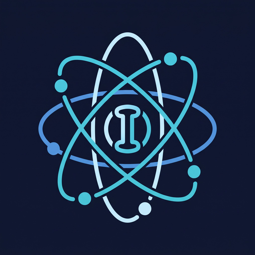
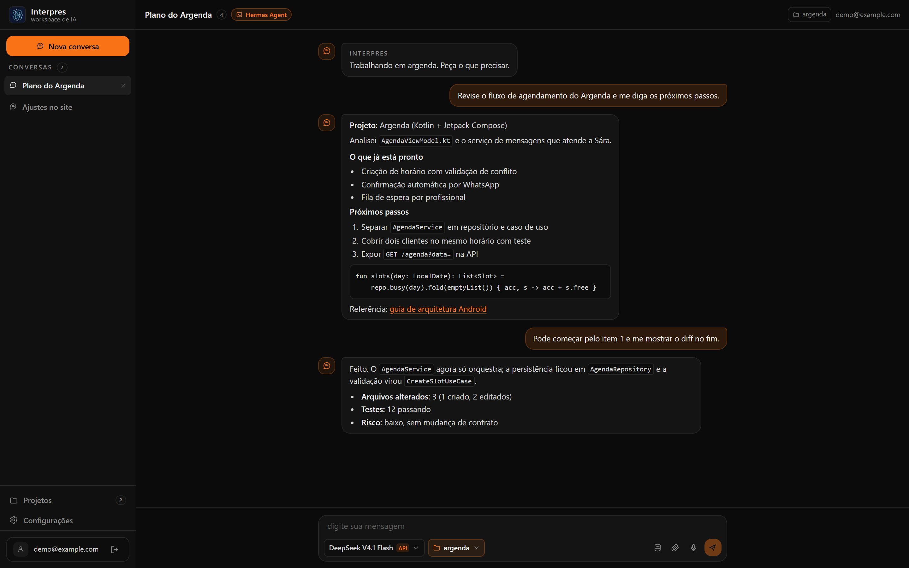
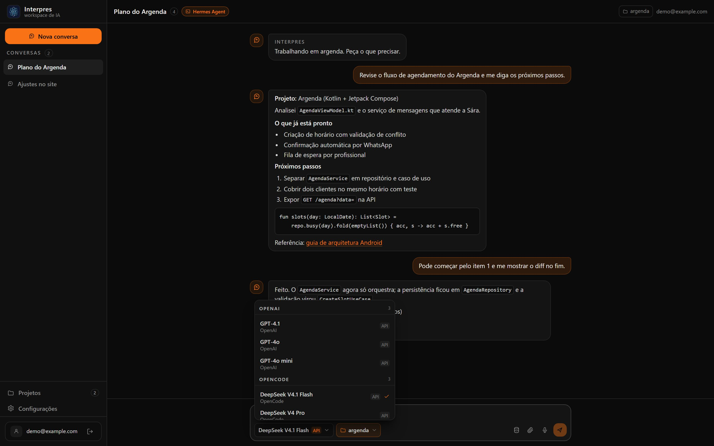
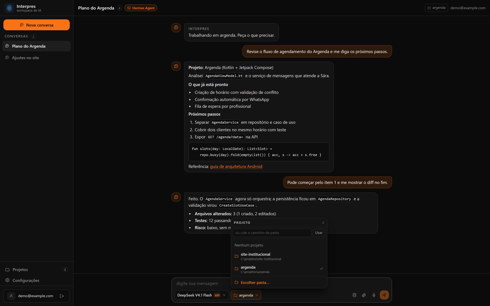
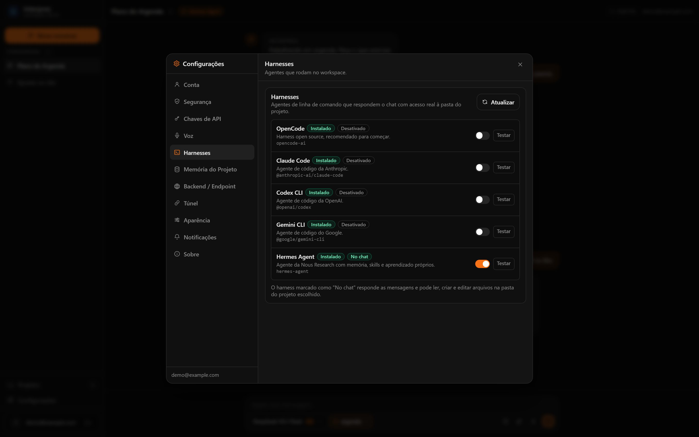

# Interpres



Self-hosted AI workspace: **your keys, your models, your files, your machine**.

[Português](README.md) · **English**

> **Status: working local build (v0.2).** Owner account, encrypted provider keys,
> persisted conversations, projects, attachments and
> real coding harnesses are running. Streaming jobs, approvals and the local agent
> come next.

| Chat | Models | Project | Harnesses |
|---|---|---|---|
|  |  |  |  |

Interpres is for people who want a hosted-AI experience **without handing their
keys, conversations and files to a third party**. Each installation has exactly
one owner account, like a self-hosted n8n. There is no public signup.

You pick the **harness** (the agent that actually runs on your machine) and the
**model** you want to pay for. Moving between harnesses does not move your data
off your machine.

## What it is for

- Chat with the model you already pay for, with saved history.
- Ask an agent to **create, edit and delete files** inside a project folder you choose.
- Use the same app with OpenCode, Claude Code, Codex, Gemini or Hermes — and switch
  whenever you want.
- Reach it from your phone through a tunnel (Cloudflare or ngrok) without opening
  router ports.

## How it works

```
 browser
    |
    v
 FastAPI (auth, conversations, projects, uploads)  --->  SQLite (local)
    |
    +--> harness on your machine (OpenCode / Claude Code / Codex / Gemini / Hermes)
             runs in the project folder, with its own tools and login
```

The harness is the **executor**. Interpres owns sessions, projects, history,
attachments and the UI. Each harness keeps its own memory (skills, learned notes)
inside itself — by design.

## What works today

### Account and security
- First-run owner creation with a one-time recovery code.
- Login, logout and server-side sessions (HttpOnly cookie) with CSRF protection.
- Recovery by code, or by e-mail when SMTP is configured.
- Optional TOTP two-factor with backup codes.
- Admin CLI: `list-users` and `reset-password`.
- Provider keys encrypted with `APP_SECRET`; the API never returns the key.
- Connected-device list with per-device revoke.
- Argon2id passwords, rate limiting and an audit log.

### Conversations
- Conversations and messages persisted and restored when the app reopens.
- Markdown replies with clickable links, lists, tables and code blocks.
- Images and files (up to 25 MB) handed to the harness.
- Screen captures sent into the conversation with the camera button or when you ask the agent (requires a desktop).
- Model picker grouped by provider, with a sticky provider header.

### Projects
- Choose the working folder with the native dialog or paste the path.
- Each project stores its uploads in `.interpres/uploads`.

### Harnesses
Interpres detects coding agents installed on the host and runs them in the project
folder with real tools:

| Harness | Command | Notes |
|---|---|---|
| OpenCode | `opencode run --auto` | attachments via `--file` |
| Claude Code | `claude -p` | auto-accepted edits |
| Codex CLI | `codex exec --full-auto` | images via `--image` |
| Gemini CLI | `gemini -p` | auto-edit approval |
| Hermes Agent | `hermes chat -q` | own memory/skills, session resumed per conversation |

Only **one harness is active at a time** (Settings → Harnesses). The active one is
shown at the top of the chat. Harnesses that accept a model can be combined with
the provider/model you select; Hermes covers the model-agnostic case.

### Operations
- Optional tunnel: Cloudflare quick link (no account), Cloudflare token and ngrok.
- SQLite with Alembic migrations (PostgreSQL is a planned option).
- Security headers and production CSP.
- Healthcheck at `/api/health`.
- One Docker image that builds the frontend and serves it from the API.

## What you need on the PC

**Option 1 — Docker (simplest):**
- Docker Desktop (Windows/macOS) or Docker + Compose (Linux).
- No Python or Node needed.

**Option 2 — local (to use harnesses for real):**
- Windows 10/11, Linux or macOS.
- Python 3.11+ and Node 20+.
- At least one harness installed and logged in:
  - OpenCode: `npm install -g opencode-ai`
  - Claude Code: official Anthropic installer
  - Codex CLI: `npm install -g @openai/codex`
  - Gemini CLI: `npm install -g @google/gemini-cli`
  - Hermes Agent: `pip install hermes-agent` and `hermes setup`

The harness must be authenticated (CLI login or API key). Interpres never stores
those credentials.

## Quick start (Docker)

```bash
git clone https://github.com/wesleyaviz873-lab/interpres.git
cd interpres
cp .env.example .env
# generate a real secret and put it in APP_SECRET:
#   openssl rand -hex 32
# production refuses the default "change-me"
docker compose up -d
```

Open <http://localhost:3000> and create the owner account.

## Local install (Windows, Linux or macOS)

```bash
cd apps/api
python -m venv .venv
.venv/Scripts/python -m pip install -r requirements-dev.txt   # Windows
# source .venv/bin/activate && pip install -r requirements-dev.txt  # Linux/macOS

cd ../web
npm install
npm run build
```

From `apps/api`, start the API pointing at the built frontend:

```powershell
# Windows PowerShell
$env:APP_ENV = "development"
$env:APP_MODE = "local"
$env:WEB_DIST_DIR = "C:\path\to\interpres\apps\web\dist"
.venv\Scripts\python -m uvicorn app.main:app --host 127.0.0.1 --port 8010
```

```bash
# Linux/macOS
APP_ENV=development APP_MODE=local WEB_DIST_DIR="$(pwd)/../web/dist" \
  .venv/bin/python -m uvicorn app.main:app --host 127.0.0.1 --port 8010
```

Open <http://127.0.0.1:8010>.

`APP_MODE=local` enables the folder picker and harnesses. `APP_MODE=server` keeps
only chat, providers and workspace tools.

## First steps

1. Create the owner account.
2. In **Settings → API keys**, paste the provider key (or point to local Ollama).
3. In **Settings → Harnesses**, click **Install** if needed, then turn on the
   harness you want to use.
4. In the chat, choose the folder in **Projeto/Project**.
5. Send the request. To pull context from an old conversation, use the database
   button next to the paperclip.

## Tunnel (phone away from home)

Use **Settings → Tunnel**:
- **Cloudflare quick**: no account, temporary URL.
- **Cloudflare token**: named tunnel, stable URL.
- **ngrok**: requires account and token.

The Docker image ships `cloudflared` and `ngrok`. See [docs/TUNEL.md](docs/TUNEL.md)
(Portuguese).

## Privacy and security

- No telemetry and no mandatory external service.
- Keys encrypted with `APP_SECRET`; the API only reports whether they are set.
- Conversations, messages, projects and attachments stay on your machine.
- `.env`, database, uploads and build output are git-ignored.
- The public repository contains no paths, e-mails, client names or keys.

See also [SECURITY.md](SECURITY.md) and [docs/02-SEGURANCA.md](docs/02-SEGURANCA.md).

## Structure

```
apps/
  api/       FastAPI, SQLAlchemy, Alembic, auth, harnesses, tests
  web/       React, TypeScript, Vite, Tailwind
docker/      Dockerfile and entrypoint
docs/        vision, architecture, security, install, usage and FAQ
```

## Documentation

- [Detailed install](docs/INSTALACAO.md) (Portuguese)
- [Usage and token savings](docs/USO.md) (Portuguese)
- [Tunnel: Cloudflare and ngrok](docs/TUNEL.md) (Portuguese)
- [Install by chatting with an AI](docs/PROMPT-IA.md) (Portuguese)
- [FAQ](docs/FAQ.md) (Portuguese)
- [Vision](docs/00-VISAO.md) · [Architecture](docs/01-ARQUITETURA.md) ·
  [Security](docs/02-SEGURANCA.md) · [Roadmap](docs/03-ROADMAP.md) ·
  [Current state](docs/07-ESTADO-ATUAL.md)

## License

MIT. See [LICENSE](LICENSE).
